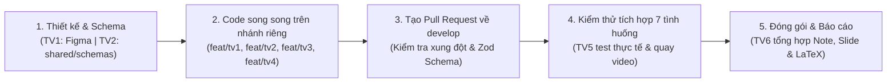

# BreakFlow – Ứng dụng Nhắc Giải lao, Vận động & Nước uống (IE307.R11)

> **Tên dự án:** **BreakFlow** (*Break* - Giải lao vận động giữa giờ & *Flow* - Duy trì nhịp độ tập trung, năng lượng)  
> **Môn học:** IE307.R11 - Công nghệ lập trình đa nền tảng cho thiết bị di động (React Native)  
> **Chủ đề Seminar (Tuần Lab 6):** Chủ đề 14 - Tích hợp các bề mặt giao diện ngoài ứng dụng chính (*Notification Actions, iOS/Android Widgets, Live Activities, Dynamic Island, Chia sẻ dữ liệu giữa Extension và React Native App*)  
> **Đối tượng người dùng trọng tâm:** Học sinh, Sinh viên & Nhân viên văn phòng ngồi học/làm việc nhiều giờ liên tục

---

## 1. Cấu trúc Thư mục Tổng thể (Project Structure)

Bộ khung dự án phân chia sẵn **cấu trúc thư mục tổng thể** theo phạm vi công việc của từng thành viên:

```text
BreakFlow/
├── README.md                        # Tổng quan luồng dự kiến, phân chia thư mục & hướng dẫn cài đặt
├── requirements.txt                 # Danh sách thư viện cần thiết & lệnh cài nhanh cho các thành viên
├── package.json                     # Khai báo dependencies chuẩn để chạy `npm install`
├── .env.example                     # Biến môi trường mẫu
├── docs/                            # [TV6] Tài liệu báo cáo, slide thuyết trình
│   └── member-notes/                # Nhật ký công việc, lỗi & hình chụp của từng thành viên (TV1 -> TV6)
├── shared/                          # [TV2 chủ trì] SINGLE SOURCE OF TRUTH (Dùng chung Client & Backend)
│   ├── constants/                   # Hằng số dùng chung (Notification IDs, ngưỡng mặc định, miễn trừ y tế)
│   ├── schemas/                     # Zod Schemas kiểm tra dữ liệu dùng chung cho cả Form Client & Backend
│   └── types/                       # TypeScript types dùng chung
├── src/                             # MÃ NGUỒN ỨNG DỤNG REACT NATIVE
│   ├── app/                         # [TV1] Khung điều hướng (React Navigation) & Deep Linking (URL State)
│   ├── components/                  # [TV1] Các thành phần giao diện dùng chung
│   ├── theme/                       # [TV1] Bố cục thích ứng (Responsive), Font chữ lớn & cấu hình RTL
│   ├── features/
│   │   ├── auth/                    # [TV2] Đăng nhập OAuth, duy trì phiên (Zustand) & tự động bắt đăng nhập lại
│   │   ├── dashboard/               # [TV1] Trang chủ, tổng phút hôm nay, tiến độ mục tiêu & chuỗi Streak
│   │   ├── activity-log/            # [TV3] Form nhập liệu (React Hook Form + Zod) & danh sách nhật ký
│   │   └── reminders/               # [TV4] Lịch nhắc, Notification Actions (Hoàn thành/Hoãn 5p) & cầu nối Widget
│   ├── services/                    # [TV2] Cấu hình gọi API (Axios + NetInfo), TanStack Query Client & Storage
│   └── utils/                       # Các hàm tiện ích dùng chung (chống bấm lặp idempotency, định dạng giờ...)
├── backend/                         # [TV2] Mã nguồn Backend API, xác thực lại bằng Zod & kiểm tra quyền sở hữu
└── tests/                           # [TV5] Ca kiểm thử, dữ liệu thử (Mock Data) & kiểm tra tích hợp 7 tình huống
```

---

## 2. Phân công Khu vực Thư mục theo Thành viên (TV1 – TV6)

| Thành viên | Phụ trách chính | Thư mục làm việc |
| :--- | :--- | :--- |
| **TV1** | UI/UX, Responsive, Font Scale (người cao tuổi), RTL, Navigation & Dashboard | `src/theme/`, `src/components/`, `src/app/`, `src/features/dashboard/` |
| **TV2** | Auth (OAuth + Session Timeout), Backend, Cloud DB & Shared Zod Schemas | `shared/`, `backend/`, `src/features/auth/`, `src/services/` |
| **TV3** | Nhập liệu (`React Hook Form` + `Zod`), chống ghi trùng & Nhật ký vận động | `src/features/activity-log/`, `src/utils/` |
| **TV4** | Lịch nhắc & Chủ đề Seminar 14 (`@notifee/react-native` Notification Actions, Widget) | `src/features/reminders/` |
| **TV5** | Kiểm thử tích hợp 7 tình huống bắt buộc, dữ liệu thử & quay video kiểm chứng | `tests/` |
| **TV6** | Tổng hợp báo cáo LaTeX, Slide Seminar Lab 6 & Cuối kỳ, điều phối nhóm | `docs/`, `docs/member-notes/` |

---

## 3. Luồng Nghiệp vụ Dự kiến (Expected Flows)

### 3.1. Luồng Ưu tiên Số 1 (MVP - Tuần Lab 6)
```text
[1. Đăng nhập OAuth (Google/Facebook)]
        │ (Lưu phiên kèm thời hạn bắt buộc đăng nhập lại)
        ▼
[2. Đặt lịch nhắc vận động & Giờ yên lặng]
        │ (Hủy lịch cũ -> Đăng ký Trigger Notification kèm 2 nút hành động)
        ▼
[3. Nhận thông báo ngoài App (khi đang khoá máy hoặc dùng app khác)]
        ├──► Bấm nút [Hoãn 5 phút] ──► Hủy thông báo hiện tại & Đặt lại lịch nhắc sau +5 phút
        │
        └──► Bấm nút [Hoàn thành] hoặc Mở App nhập Form (React Hook Form + Zod)
                    │ (Đính kèm idempotencyKey chống ghi trùng lặp)
                    ▼
[4. Backend xác thực lại bằng cùng Zod Schema & Kiểm tra quyền sở hữu (userId)]
                    │
                    ▼
[5. Cập nhật Tiến độ Trang chủ (TanStack Query), Chuỗi Streak & Đồng bộ sang Widget]
```

### 3.2. Phân tầng Quản lý Trạng thái (State Management)
- **Server State:** `@tanstack/react-query` (dữ liệu nhật ký, thống kê ngày/tuần từ API).
- **Client / UI State:** `zustand` + `expo-secure-store` (phiên đăng nhập, bộ đếm đang chạy, cấu hình chữ lớn).
- **Form State:** `react-hook-form` + `@hookform/resolvers` (thay thế hoàn toàn `useState` rời rạc trên các form nhập liệu).
- **Validation (Single Source of Truth):** `zod` đặt tại `shared/schemas/` dùng chung cho cả Client và Backend.
- **URL / Deep Link State:** `@react-navigation/native` + `expo-linking` (điều hướng từ Notification / Widget vào đúng màn hình).

---

## 4. Pipeline Phát triển & Kiểm thử của Nhóm (Development Pipeline)



### Danh sách 7 tình huống kiểm thử tích hợp bắt buộc (TV5 kiểm tra trước khi merge vào `main`):
1. **Mất mạng khi đăng nhập:** Thông báo lỗi rõ ràng, cho phép thử lại, giữ đúng trạng thái phiên.
2. **Mất mạng khi lưu vận động:** Không báo thành công sai, cho phép thử lại đúng khi có mạng.
3. **Đổi lịch nhắc:** Lịch cũ được hủy hoàn toàn, lịch mới hoạt động đúng.
4. **Đăng xuất hoặc đổi tài khoản:** Xóa phiên, dữ liệu lưu trên máy và hủy toàn bộ lời nhắc của tài khoản cũ.
5. **Truy cập dữ liệu tài khoản khác:** Backend từ chối truy cập trái quyền (`403 Forbidden`).
6. **Bấm lưu nhiều lần:** Giao diện khóa nút chống bấm lặp, phía lưu dữ liệu xử lý yêu cầu gửi lại (`idempotencyKey`).
7. **Bấm lại hành động thông báo:** Không tạo thao tác thừa hoặc dữ liệu trùng ngoài ý muốn.

---

## 5. Hướng dẫn Tải Nhanh Thư viện cho Thành viên

1. **Sao chép file biến môi trường:**
   ```bash
   cp .env.example .env
   ```
2. **Cách 1 – Cài đặt tự động toàn bộ thư viện qua `package.json`:**
   ```bash
   npm install
   ```
3. **Cách 2 – Xem hoặc cài đặt theo danh sách trong [`requirements.txt`](./requirements.txt):**
   - Xem chi tiết từng nhóm thư viện theo vai trò thành viên trong file [`requirements.txt`](./requirements.txt).
   - Hoặc chạy lệnh đọc trực tiếp từ `requirements.txt` (PowerShell):
     ```powershell
     npm install (Get-Content requirements.txt | Where-Object { $_ -and -not $_.StartsWith('#') })
     ```
