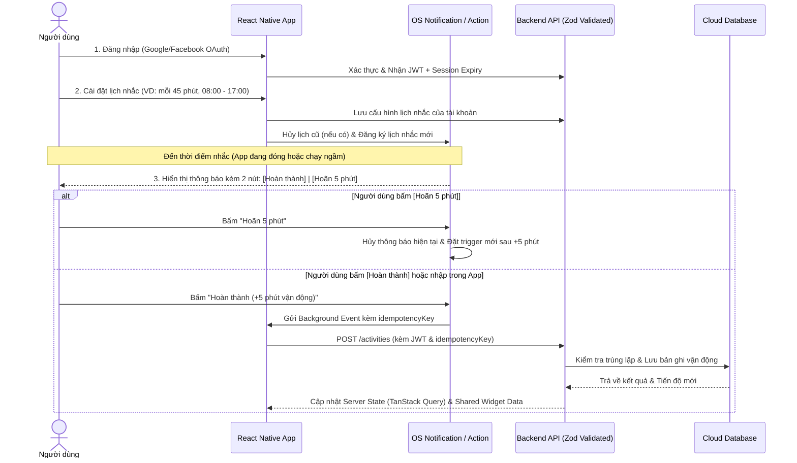

# TÀI LIỆU MÔ TẢ NGHIỆP VỤ (BUSINESS SPECIFICATION)

## 1. Giải quyết 5 Câu hỏi Cốt lõi của Đồ án

Dựa trên góp ý của giảng viên và thống nhất của cả nhóm, dưới đây là định nghĩa nghiệp vụ chính thức của dự án:

### 1.1. Người dùng chính là ai & Vấn đề của họ là gì?
* **Đối tượng chính:** Nhân viên văn phòng và Sinh viên học tập/làm việc ngồi nhiều trước máy tính.
* **Đối tượng mở rộng (Accessibility):** Người cao tuổi hoặc người cần giao diện chữ lớn, dễ đọc để theo dõi thói quen vận động nhẹ nhàng hằng ngày.
* **Vấn đề gặp phải:**
  1. Ngồi liên tục nhiều giờ, quên đứng dậy vận động hoặc uống nước.
  2. Các thông báo nhắc nhở thông thường dễ gây phiền nhiễu trong giờ làm việc/học tập hoặc bắt người dùng phải mở ứng dụng qua nhiều bước mới ghi nhận được dẫn đến bỏ cuộc.
  3. Khó duy trì thói quen dài hạn nếu thiếu cơ chế theo dõi chuỗi ngày liên tiếp (**Streak**) và so sánh tiến độ trực quan.

### 1.2. Ứng dụng theo dõi chỉ số trọng tâm nào?
1. **Trọng tâm số 1 (MVP Lab 6):** **Thời lượng vận động / đứng dậy nghỉ ngơi** (tính bằng số phút/ngày và số phiên hoàn thành) để phá vỡ thời gian ngồi liên tục.
2. **Trọng tâm số 2 (Mở rộng):** **Lượng nước uống (ml)** và **chế độ dinh dưỡng cơ bản (kcal ước tính)** trong ngày.

### 1.3. Nguồn dữ liệu đến từ đâu?
* **Ghi nhận nhanh từ bề mặt ngoài ứng dụng:** Người dùng bấm nút **"Hoàn thành"** ngay trên thông báo nhắc nhở (Notification Action) hoặc Widget.
* **Người dùng tự nhập tay (Manual Input):** Nhập qua biểu mẫu trong ứng dụng (loại hoạt động, thời lượng phút, lượng nước/dinh dưỡng).
* **Bộ đếm phiên (Session Timer):** Đếm thời gian phiên đi bộ / phiên ngồi làm việc (kết hợp Live Activities / Ongoing Notification).

### 1.4. Người dùng thực hiện việc gì ngoài App nhiều nhất?
* **Phản hồi lời nhắc ngay trên Notification (Notification Actions):** Bấm *"Hoàn thành (Ghi nhanh)"* khi vừa đứng dậy vươn vai/đi bộ, hoặc bấm *"Hoãn 5 phút"* khi đang bận họp/làm bài.
* **Xem nhanh tiến độ trên Màn hình chính / Màn hình khóa (Widgets & Live Activities):** Liếc nhìn số phút vận động hôm nay và chuỗi Streak mà không cần mở app.

### 1.5. Ba nhóm chức năng chính của ứng dụng là gì?
1. **Nhắc nhở thông minh & Tương tác ngoài ứng dụng (Smart Reminders & External Surfaces):** Đặt lịch nhắc theo khung giờ làm việc, giờ yên lặng (Quiet Hours), xử lý Notification Actions (Hoàn thành / Hoãn 5p), đồng bộ Widget & Live Activities.
2. **Nhật ký Vận động & Dinh dưỡng/Nước uống (Activity & Hydration Logging):** Ghi nhận hoạt động có kiểm tra dữ liệu chặt chẽ (Zod), chống ghi trùng, tự động tính toán lại lượng nước/thời gian vận động khuyến nghị.
3. **Bảng điều khiển Tiến độ, Chuỗi (Streak) & Xu hướng (Dashboard & Analytics):** Theo dõi mục tiêu ngày, giữ chuỗi ngày liên tiếp, biểu đồ so sánh tuần này với tuần trước và cảnh báo khi vượt ngưỡng ngồi lâu do người dùng tự cấu hình.

---

## 2. Tuyên bố Miễn trừ Trách nhiệm Y tế (Medical Disclaimer)

> [!IMPORTANT]
> **Quy định bắt buộc trong ứng dụng:**  
> Toàn bộ các tính năng tính toán mục tiêu vận động, lượng nước uống, dinh dưỡng và cảnh báo vượt ngưỡng ngồi lâu trong ứng dụng chỉ mang tính chất **hỗ trợ theo dõi và xây dựng thói quen sinh hoạt cá nhân**, **hoàn toàn không thay thế cho chẩn đoán, tư vấn hoặc điều trị y tế chuyên nghiệp**.

---

## 3. Luồng Nghiệp vụ Ưu tiên (MVP - Báo cáo Tuần Lab 6)

